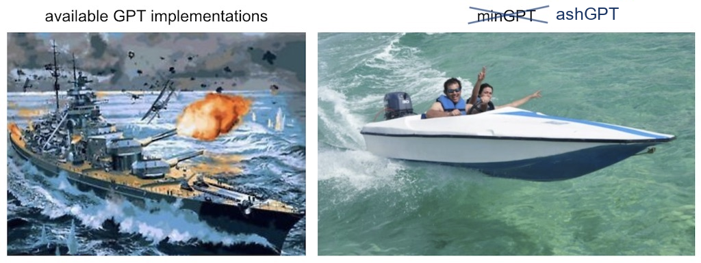

# ashGPT

**A small GPT training playground maintained by Ajinkya Katke**

[](https://colab.research.google.com/github/AsHx-BiT/ashGPT-training/blob/main/notebooks/ashGPT_tiny_shakespeare_Colab.ipynb)



ashGPT is a GPT training project based on the nanoGPT codebase. It includes the Transformer model, data preparation scripts, a training loop, and a sampler. Train the model on text, save a checkpoint, then generate continuations from a prompt.

The included starter example trains a small character-level model on Shakespeare. It is intended for learning and experimentation; it generates text continuations and is not an interactive chatbot.

## Install

Run these commands from the ashGPT folder in PowerShell:

```powershell
python -m pip install -r requirements.txt
```

This installs PyTorch and the libraries used by the training and data preparation scripts.

## Quick start: train on Shakespeare

Prepare the dataset. This downloads the text, creates the train and validation files, and builds tokenizer metadata:

```powershell
python data/shakespeare_char/prepare.py
```

### Training on CPU

This smaller setup is suitable for a CPU and uses 500 training iterations:

```powershell
python train.py config/train_shakespeare_char.py --device=cpu --compile=False --eval_iters=10 --log_interval=50 --block_size=64 --batch_size=12 --n_layer=4 --n_head=4 --n_embd=128 --max_iters=500 --lr_decay_iters=500 --warmup_iters=10 --eval_interval=100 --dropout=0.0
```

Training prints the loss as it runs. At the end, the checkpoint is saved in `out-shakespeare-char/ckpt.pt`.

### Training on a GPU

With a CUDA-enabled PyTorch installation and a compatible GPU, start with the included configuration:

```powershell
python train.py config/train_shakespeare_char.py
```

The configuration uses a larger model and longer training run than the CPU example. Adjust its settings to fit your GPU memory and training time.

## Generate text

Generate five continuations from a character prompt:

```powershell
python sample.py --out_dir=out-shakespeare-char --start="ROMEO:" --num_samples=5 --max_new_tokens=200 --device=cpu
```

For GPU sampling, use `--device=cuda` if CUDA is available. You can change `--start`, `--num_samples`, and `--max_new_tokens` to explore different prompts and output lengths.

Because the starter model learns character patterns from Shakespeare, its output imitates that text and may be rough, especially after a short CPU training run. It does not answer questions like an instruction-tuned assistant.

## Project structure

- `model.py` defines the GPT-style Transformer.
- `train.py` prepares batches, trains the model, evaluates loss, and saves checkpoints.
- `sample.py` loads a checkpoint and generates text.
- `config/` contains training configurations.
- `data/` contains dataset preparation scripts.
- `notebooks/ashGPT_tiny_shakespeare_Colab.ipynb` runs the compact pasted Transformer example in Colab.
- `notebooks/ashGPT_Colab.ipynb` runs the repository's main nanoGPT training workflow in Colab.

To experiment with a different dataset or model size, prepare the data in the format expected by a dataset's `prepare.py` script and adjust the training configuration in `config/`.

## Compact from-scratch Colab notebook

[Open the ashGPT tiny Shakespeare notebook in Google Colab](https://colab.research.google.com/github/AsHx-BiT/ashGPT-training/blob/main/notebooks/ashGPT_tiny_shakespeare_Colab.ipynb). It runs the compact Transformer example in `train_tiny_shakespeare.py`.

## Troubleshooting

If PyTorch compilation is unavailable on your system, use `--compile=False`. On Windows without a CUDA-enabled GPU, use `--device=cpu` as shown in the CPU command.

## License

See [LICENSE](LICENSE) for the license and required notices.
